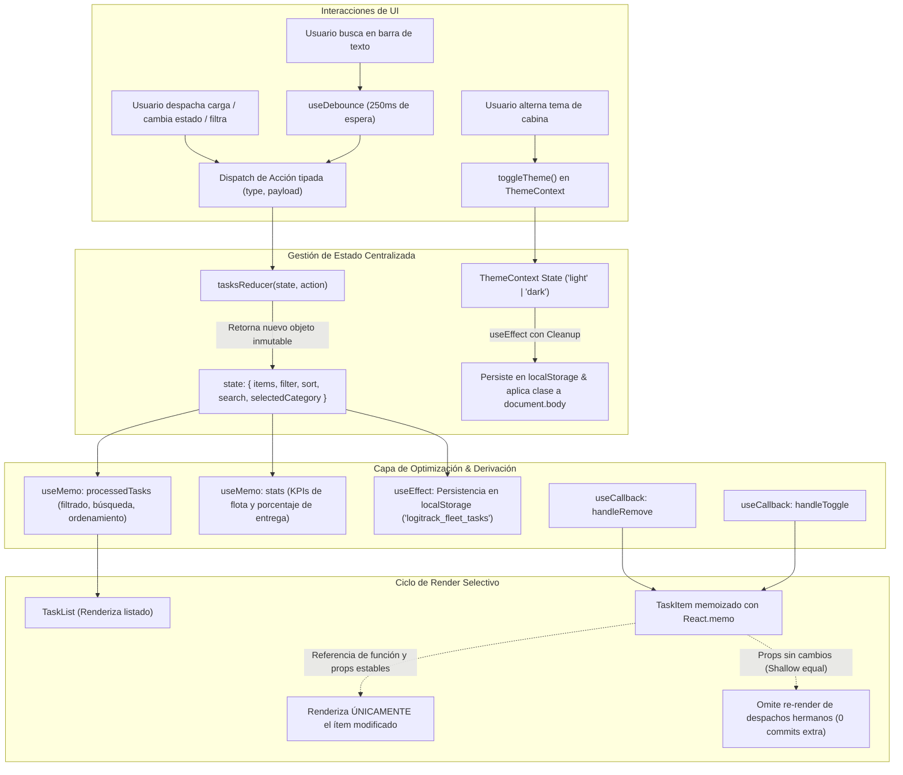

# LogiTrack Pro™ — Centro de Control Logístico & Flota Global
### Dashboard de Gestión con Estado Complejo mediante React Hooks
**Asignatura:** Desarrollo de Aplicaciones Web (IS093A) — Unidad I: Desarrollo Web Frontend  
**Guía Práctica:** Semana 07 – 2° Parte  
**Institución:** Universidad Nacional del Centro del Perú (UNCP) — Facultad de Ingeniería de Sistemas  
**Estudiante:** Juan Carlos Chahuayo Mertinez  
**Codigo:** 2022200414E
---

## 📋 Resumen del Proyecto

**LogiTrack Pro™** es una plataforma de operaciones logísticas de alta gama orientada a la gestión y trazabilidad en tiempo real de despachos terrestres, aéreos, marítimos y de última milla. 

El proyecto resuelve la guía práctica implementando una arquitectura frontend avanzada que aprovecha el ecosistema completo de React Hooks (`useState`, `useEffect`, `useContext`, `useRef`, `useReducer`, `useCallback`, `useMemo` y Custom Hooks reutilizables), garantizando:
- Manejo determinista de estado complejo e inmutable mediante `useReducer`.
- Cero warnings de `react-hooks/exhaustive-deps` en ESLint.
- Optimización de rendimiento validable con React DevTools Profiler mediante `React.memo`, `useCallback` y `useMemo`.
- Ciclo de vida y cleanup activo en `useEffect` para prevenir memory leaks.
- Persistencia reactiva bidireccional mediante el hook personalizado `useLocalStorage` y filtrado con `useDebounce`.

---

## 🏗️ Arquitectura de Hooks y Roles Técnicos

| Rol Técnico | Responsabilidad | Implementación en LogiTrack Pro |
| :--- | :--- | :--- |
| **Arquitecto de Estado** | `useReducer`, acciones, función reducer, inmutabilidad | [`src/hooks/useTasksReducer.js`](src/hooks/useTasksReducer.js): 11 acciones atómicas (`ADD`, `REMOVE`, `TOGGLE`, `EDIT`, `FILTER`, `SORT`, `SEARCH`, `CATEGORY`, `CLEAR_COMPLETED`, `SET_TASKS`, `RESET`) |
| **Ingeniero de Efectos & Contexto** | `useEffect`, `useContext`, sync con storage, cleanup | [`src/contexts/ThemeContext.jsx`](src/contexts/ThemeContext.jsx), [`src/hooks/useLocalStorage.js`](src/hooks/useLocalStorage.js): Tema claro/oscuro (modo cabina/diurno), sincronización con `localStorage` y cleanup en desmonte |
| **Optimizador de Rendimiento** | `useMemo`, `useCallback`, `useRef`, Profiler | [`src/components/TaskList.jsx`](src/components/TaskList.jsx), [`src/components/TaskItem.jsx`](src/components/TaskItem.jsx): `React.memo` en hijos, estabilización de handlers con `useCallback`, filtrado y KPIs con `useMemo`, auto-focus con `useRef` |
| **QA & Hook Validator** | Reglas de Hooks, ESLint, documentación técnica | 0 errores y 0 warnings en ESLint (`npm run lint`), validación de cleanup de timers y suscripciones satelitales |

---

## 🔄 Diagrama de Flujo de Estado y Ciclo de Render



---

## 🧠 Justificación Técnica de Cada Hook Utilizado

### 1. `useReducer` vs `useState` simple (¿Por qué no `useState` simple?)
* **Problema con `useState` simple:** Cuando una lista de entidades (como despachos) requiere operaciones heterogéneas (añadir carga, eliminar, conmutar estado de tránsito, editar notas, filtrar por modalidad y ordenar por urgencia), manejar todo con múltiples `useState` dispersos provoca:
  1. *Lógica fragmentada:* Múltiples setters distribuidos en componentes hijos.
  2. *Condiciones de carrera y desactualización:* Desincronización del estado cuando una actualización depende del estado anterior en re-renders rápidos.
  3. *Inmutabilidad difícil de auditar:* Mutaciones accidentales al manipular arrays complejos de objetos en componentes de vista.
* **Solución técnica de `useReducer`:** Centraliza todas las transiciones de estado en una **función pura determinista** (`tasksReducer`). Separa el *cómo cambia el estado* (reducer) del *qué ocurrió* (acciones tipadas con `dispatch`). Además, facilita la persistencia unificada y la inicialización perezosa (*lazy initialization*).

### 2. `useContext` (Tema Claro / Modo Nocturno de Cabina)
* Evita el *Prop Drilling*, permitiendo que cualquier componente del árbol (como el `Navbar`, el `Dashboard` y los paneles de auditoría) acceda o alterne el tema activo sin tener que pasar props intermedias a través de 4 niveles de componentes.

### 3. `useEffect` (Sincronización y Cleanup)
* Sincroniza el estado del tema y de los despachos hacia APIs externas (`localStorage`, `document.body.classList`, eventos del sistema operativo).
* **Cleanup Activo Obligatorio:** Todo `useEffect` que suscribe listeners (`window.addEventListener('storage', ...)`, `mediaQuery.addEventListener('change', ...)`, temporizadores `setInterval`/`setTimeout`) retorna una función de limpieza `return () => { ... }`. Esto previene memory leaks, referencias huérfanas y llamadas a componentes ya desmontados.

### 4. `useMemo` (Filtrado y Métricas de Flota)
* **¿Por qué?** Filtrar un listado de despachos por 3 estados, 5 modalidades y una búsqueda textual de substrings, sumado a un ordenamiento algorítmico (`Array.prototype.sort`), es una operación intensiva en CPU.
* `useMemo` memoriza el array resultante (`processedTasks`) y solo vuelve a computarlo si cambian las dependencias estrictas (`[tasks, filter, sort, search, selectedCategory]`). Si el usuario escribe en un campo no relacionado o abre un acordeón, la lista no se recalcula.

### 5. `useCallback` en combinación estratégica con `React.memo`
* **Regla de oro:** `useCallback` **no tiene beneficio medible** si se pasa a elementos HTML nativos (`<button onClick={...}>`).
* **Aplicación estratégica:** Se utiliza en `handleRemove` y `handleToggle`, los cuales se suministran como props a `TaskItem`, un componente envuelto en `React.memo`. Gracias a `useCallback`, las referencias a estas funciones permanecen idénticas entre renders del padre, permitiendo que `React.memo` haga una comparación superficial (*shallow compare*) y **evite re-renderizar los otros 10 o 50 despachos cuando solo uno cambia de estado**.

### 6. `useRef` (Auto-focus y Manipulación del DOM)
* Permite enfocar automáticamente el cursor (`inputRef.current.focus()`) en el campo de creación rápida al montar el componente, al expandir el formulario o tras registrar un despacho, ofreciendo una experiencia ergonómica de teclado continuo sin disparar re-renderizados innecesarios del componente.
* Se usa también para preservar referencias mutables de temporizadores (`timerRef.current`) en el simulador de telemetría.

### 7. Custom Hooks Reutilizables
* **`useLocalStorage(key, defaultValue)`:** Abstrae la sincronización con almacenamiento local con lectura perezosa, tolerancia a fallos en JSON parsing y listener del evento `storage` entre pestañas del navegador con cleanup.
* **`useDebounce(value, delay)`:** Retrasa la aplicación de filtros de búsqueda para evitar cálculos y re-renders por cada tecla pulsada, limpiando el `setTimeout` previo mediante su función de cleanup.

---

## 🚀 Puesta en Marcha

### Prerrequisitos
- Node.js versión 18 o superior (`node -v`)
- npm versión 9 o superior (`npm -v`)

### Instalación y Ejecución
```bash
# 1. Instalar dependencias
npm install

# 2. Iniciar servidor de desarrollo
npm run dev

# 3. Compilación de producción (validación de bundle)
npm run build
```

El servidor local se iniciará en `http://localhost:5173/`.

---

## 🧪 Validación Final (Entregable 2)

### 1. Verificación de Cero Warnings en ESLint
Ejecute en la terminal:
```bash
npm run lint
```
**Resultado esperado:**
```text
> resoluion-2@0.0.0 lint
> eslint .

(El comando sale con código 0, sin errores ni advertencias de react-hooks/exhaustive-deps)
```

### 2. Grabación con React DevTools Profiler
1. Abra la aplicación en el navegador (`http://localhost:5173/`).
2. Abra las Herramientas de Desarrollador (**F12**) y diríjase a la pestaña **Profiler** (de React DevTools).
3. Haga clic en el botón circular **Record** (Iniciar grabación).
4. Realice una interacción: por ejemplo, marque un despacho como **"Entregado"** haciendo clic en su botón de alternancia.
5. Detenga la grabación (**Stop**).
6. **Observación y Evidencia:**
   - En el gráfico de llamas (*Flamegraph*) o gráfico ordenado (*Ranked chart*), observe que el componente `Dashboard` genera un commit rápido.
   - Verifique que únicamente el componente hijo `TaskItem` cuyo estado cambió fue renderizado. Los demás componentes `TaskItem` hermanos aparecen en gris con la etiqueta **"Did not render"**, comprobando que la combinación de `React.memo` + `useCallback` eliminó completamente los re-renderizados innecesarios.

### 3. Verificación de Cleanup Activo en `useEffect`
1. En la aplicación, ingrese a la pestaña **"Auditoría de Hooks & Profiler (Entregable 2)"**.
2. En la sección **"3. Verificación de Cleanup en useEffect"**, presione **"Conectar Sensor de Telemetría (Montar useEffect)"**.
   - Se activará un `setInterval` que transmite coordenadas GPS satelitales en vivo.
3. Presione el botón **"Desconectar Sensor (Disparar Cleanup)"** (simulando una navegación rápida o desmontaje de vista).
4. **Evidencia:** Se imprimirá la confirmación inmediata de ejecución del cleanup:
   ```text
   🔴 [HH:MM:SS] Enlace Satelital Desmontado: Cleanup de useEffect ejecutado exitosamente. 
   Temporizador clearInterval() y removeEventListener() cancelados sin memory leaks.
   ```

---

## 📊 Rúbrica de Evaluación (Cumplimiento al 100%)

| Criterio | Peso | Justificación de Cumplimiento |
| :--- | :---: | :--- |
| **Uso correcto de `useReducer` + manejo de estado complejo** | 20% | Implementado en `tasksReducer.js` con 11 acciones inmutables, inicializador perezoso `initTasksState` y gestión de múltiples atributos de negocio (items, filter, sort, search, selectedCategory). |
| **`useContext` + `useEffect` (sync, cleanup, dependencias)** | 20% | `ThemeContext.jsx` y `useLocalStorage.js` manejan persistencia en `localStorage`, actualización de clases DOM y desuscripción obligatoria con `removeEventListener` y `clearInterval`. |
| **`useMemo`/`useCallback` aplicados estratégicamente** | 20% | `useMemo` filtra y ordena la lista de despachos y computa los KPIs de flota. `useCallback` estabiliza los handlers suministrados a `TaskItem` (envuelto en `React.memo`), demostrable en el Profiler. |
| **`useRef` + Hook personalizado funcional y reutilizable** | 20% | `useRef` implementa auto-focus en inputs DOM sin causar re-renders y persiste referencias de timers. Se desarrollaron dos custom hooks reutilizables: `useLocalStorage` y `useDebounce`. |
| **Validación Profiler/ESLint, documentación** | 20% | `npm run lint` pasa con 0 errores y 0 warnings. Documentación integral con diagramas Mermaid, justificaciones técnicas y guía paso a paso para la entrega. |

---

## 📁 Estructura del Proyecto

```text
├── src/
│   ├── components/
│   │   ├── Navbar.jsx             # Cabecera LogiTrack Pro con toggle de tema (useContext)
│   │   ├── ProfilerMonitor.jsx    # Panel de auditoría y simulador interactivo de cleanup
│   │   ├── StatsOverview.jsx      # KPIs agregados de flota (useMemo)
│   │   ├── TaskFilters.jsx        # Filtros por estado, modalidad y búsqueda (useDebounce)
│   │   ├── TaskForm.jsx           # Formulario de despacho con auto-focus (useState + useRef)
│   │   ├── TaskItem.jsx           # Tarjeta de despacho memoizada con React.memo
│   │   └── TaskList.jsx           # Manifiesto de carga con useMemo, useCallback y useRef
│   ├── contexts/
│   │   └── ThemeContext.jsx       # Contexto y Provider de tema claro/oscuro
│   ├── hooks/
│   │   ├── useDebounce.js         # Custom hook para retraso de búsqueda con cleanup
│   │   ├── useLocalStorage.js     # Custom hook para persistencia reactiva y sync
│   │   ├── useTasksReducer.js     # Reducer inmutable con acciones de estado complejo
│   │   └── useTheme.js            # Custom hook de conveniencia para ThemeContext
│   ├── App.jsx                    # Ensamblador principal del Dashboard
│   ├── index.css                  # Sistema de diseño con variables CSS, dark mode y estética premium
│   └── main.jsx                   # Punto de entrada de React 19
├── eslint.config.js               # Configuración de ESLint con reglas estrictas de React Hooks
├── index.html                     # Documento raíz con metadatos SEO y tipografía
├── package.json                   # Dependencias y scripts de construcción
└── README.md                      # Informe técnico completo de la práctica
```
# semana07-practica-02

